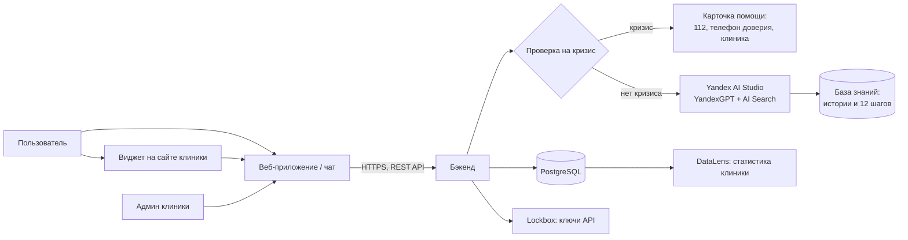
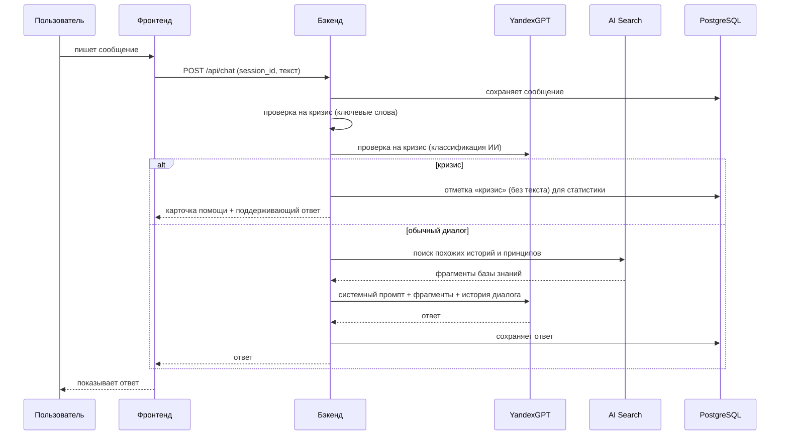

# 4. Архитектура

## 4.1 Общая схема



Подробная схема — `docs/architecture.excalidraw`.

## 4.2 Компоненты

| Компонент | Что делает | Технологии (предварительно) | Ответственный |
|---|---|---|---|
| Фронтенд | Чат, виджет, демо-страница клиники, кабинет клиники | React + TypeScript (Vite) | Карим |
| Бэкенд | API, логика диалога, проверка кризиса, работа с ИИ и БД | Python + FastAPI | Данила |
| ИИ-консультант | Генерация ответов в роли равного | YandexGPT (Yandex AI Studio) | Данила |
| База знаний | Поиск по историям выздоровления и принципам шагов | AI Search (Yandex AI Studio) | Данила, Карим (наполнение) |
| База данных | Сессии, сообщения, счётчики, клиники, статистика | PostgreSQL (Yandex Managed PostgreSQL) | Данила |
| Аналитика | Дашборд для клиники | Yandex DataLens | — (если успеем) |

## 4.3 Как обрабатывается сообщение



**Проверка на кризис — в два слоя:**
1. Быстрый фильтр по ключевым словам и фразам (работает даже если ИИ недоступен).
2. Классификация через YandexGPT отдельным коротким промптом («есть ли угроза жизни: да/нет»).

Если хотя бы один слой сказал «кризис» — включается кризисный сценарий. Лучше перестраховаться.

## 4.4 Данные (предварительная модель)

| Таблица | Основные поля |
|---|---|
| `clinics` | id, название, телефон, адрес, сайт, ключ виджета |
| `sessions` | id (анонимный), clinic_id, дата начала трезвости, режим (пациент / родственник), created_at |
| `messages` | id, session_id, роль (user / bot), текст, is_crisis, оценка, created_at |
| `clinic_admins` | id, clinic_id, логин, хэш пароля |

Никаких имён, телефонов и email пользователей не храним. История удаляется по кнопке пользователя.

## 4.5 Основные эндпоинты API (черновик)

| Метод | Путь | Назначение |
|---|---|---|
| POST | `/api/sessions` | Создать анонимную сессию (с clinic_id из виджета) |
| POST | `/api/chat` | Отправить сообщение, получить ответ |
| GET | `/api/sessions/{id}/messages` | История диалога |
| DELETE | `/api/sessions/{id}` | Удалить историю |
| PUT | `/api/sessions/{id}/sober-date` | Установить дату начала трезвости |
| GET | `/api/clinics/{id}/help` | Контакты помощи клиники |
| POST | `/api/messages/{id}/rating` | Оценка ответа |

## 4.6 Виджет

Клиника вставляет на свой сайт одну строку:

```html
<script src="https://<наш-домен>/widget.js" data-clinic="KEY"></script>
```

Скрипт рисует кнопку «Поговорить» в углу и по нажатию открывает наш чат во встроенном окне (iframe), передавая ключ клиники.

## 4.7 Инфраструктура и развёртывание

| Что | Где |
|---|---|
| Контейнеры | **Docker**: отдельные образы для бэкенда и фронтенда |
| Локальный запуск | `docker-compose up` — бэкенд, фронтенд и PostgreSQL одной командой |
| Хранение образов | Yandex Container Registry |
| Запуск бэкенда | Yandex Serverless Containers |
| Фронтенд | Yandex Object Storage (статический хостинг) |
| База данных | Yandex Managed Service for PostgreSQL |
| Секреты (ключи API) | Yandex Lockbox |
| Код | GitHub (основной) + SourceCraft (зеркало) |
| CI/CD | Сборка и тесты при каждом Pull Request |
| Задачи | Яндекс Трекер |

## 4.8 Тестирование

| Уровень | Что проверяем | Инструменты |
|---|---|---|
| Бэкенд, unit | Проверка кризиса, работа API, работа с БД | pytest |
| Фронтенд, unit | Компоненты чата и виджета | Vitest |
| e2e | Полный сценарий: открыть виджет → написать → получить ответ; кризисная фраза → карточка помощи | Playwright |

## 4.9 Риски архитектуры

| Риск | Что делаем |
|---|---|
| ИИ дал неуместный совет | Жёсткий системный промпт, двухслойная проверка кризиса, предупреждение в интерфейсе |
| YandexGPT недоступен | Фильтр кризиса работает без ИИ; пользователю показывается сообщение и контакты помощи |
| Стоимость запросов к ИИ | Ограничение длины истории в запросе, лимит сообщений на сессию |
| Утечка данных | Анонимность, HTTPS, секреты в Lockbox, данные в РФ |
